```{r}
#| label: setup
#| include: false
knitr::opts_chunk$set(collapse = TRUE, comment = "#>")
```

## Eight architectures, drawn from the models

Every diagram below was produced by `plot_architecture()` from a loaded
model — not drawn by hand and not transcribed from a paper. The stages
come from the backend's own description of its network; the widths, head
counts and parameter totals are read off the network that was built from
the published checkpoint's `config.json`.

The layout owes its shape to Sebastian Raschka's
[LLM architecture gallery](https://sebastianraschka.com/llm-architecture-gallery/):
blocks stacked in the order they run, repeated blocks drawn once with
their repeat count, a fact sheet underneath. Under that, a key defines
every symbol in the shapes, every abbreviation and every piece of
notation the diagram uses, so a figure still reads when it is shared on
its own. What is different here is
the thing that makes a tabular foundation model a tabular foundation
model, and which a language model has no equivalent of: **an attention
layer has an axis**. It can run down a column, across a row's features,
or over the rows of the table. Each attention block carries that axis as
a tag, and it is the single most useful thing to compare across the eight.

```{r}
#| label: backends
library(tabfound)
list_backends()
```

Drawing any of them is two lines:

```{r}
#| eval: false
clf <- tabular_classifier("tabpfn-v2.5-classifier")
plot_architecture(clf, "tabpfn.svg")
```

`file = NULL` draws on the current graphics device instead, so
`plot(clf)` works the way it does for any other model object. The
extension picks the format — `.svg`, `.png` or `.pdf`.

### How these particular figures were made

The vignette ships the SVGs rather than building them, because
instantiating all eight networks at their published widths allocates
about 2 billion parameters and takes a couple of minutes — too much
to pay on every `R CMD build`. The script that made them is
[`inst/gallery/make-gallery.R`](https://github.com/mneunhoe/tabfound/blob/main/inst/gallery/make-gallery.R):

```bash
Rscript inst/gallery/make-gallery.R vignettes/figures
```

It reads each model's `config.json` and builds the network **without
loading any weights**. That is not a shortcut for the numbers: a
diagram depends on the config, which fixes the architecture, and on the
*shapes* of the parameters, which the config fixes too. Nothing on
these figures depends on the values in the tensors, so a randomly
initialised network reports exactly what the trained one does. It is
also why the script needs no gigabytes on disk — for TabFM and Mitra it
fetches a few hundred bytes of JSON and nothing else, and for Kumo
Tabular, whose publisher ships bare state dicts, it reads the config the
package's converter derived and keeps in its architecture table.


## The three TabPFN generations

The clearest comparison in the gallery, because the three are the same
lineage and you can watch the design change.

### TabPFN v2.5

One embedding pass, then 24 identical layers that each attend twice —
across a row's feature groups, then down each feature's column — and a
two-layer decoder. The two attentions *are* the architecture; nothing
else in the stack moves information between rows or between columns.

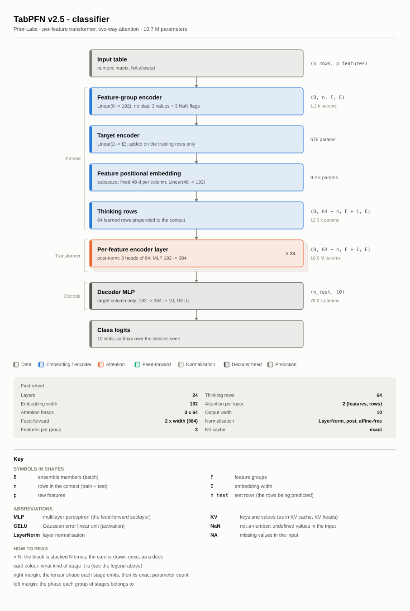{fig-alt="Stacked block
diagram of the TabPFN v2.5 classifier"}

### TabPFN v2.6

The same two-way shape, restated: RMSNorm instead of an affine-free
LayerNorm, no biases anywhere, and the target promoted from a side
input to a column of its own that the prediction is read back out of.
The whole parameter difference is those norms — v2.5's LayerNorms have
nothing to learn, v2.6's three RMSNorms per block have 192 weights
each, and 24 × 3 × 192 = 13,824 is exactly the gap between 10,718,218
and 10,732,042.

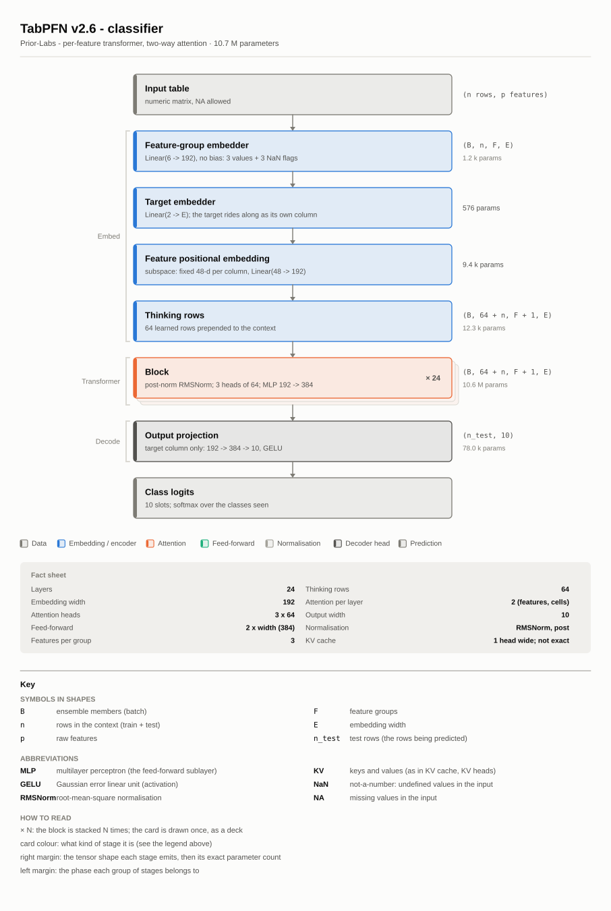{fig-alt="Stacked block
diagram of the TabPFN v2.6 classifier"}

### TabPFN v3

v3 gives up the single stack that attends both ways and splits the work
into three: summarise each column's distribution over the rows,
aggregate a row's columns into a fixed-width vector, then run a deep
in-context stack over rows at that wider width. Note where the
parameters went — 51.4 M of 53.2 M sit in stage 3, at a width of 512
rather than 128, because the column aggregator reads out four CLS
tokens and 4 × 128 = 512.

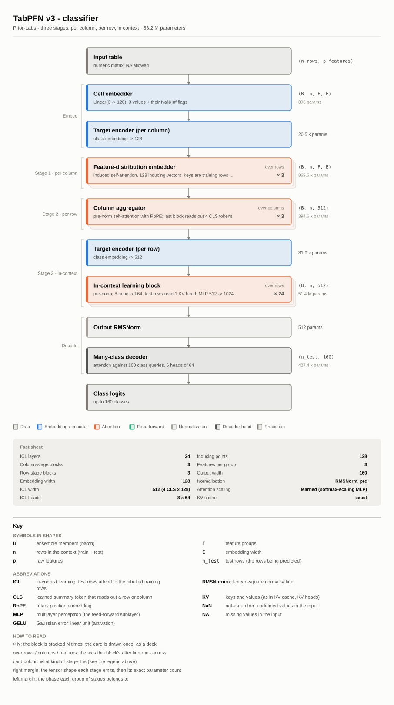{fig-alt="Stacked block
diagram of the TabPFN v3 classifier"}

## The other four architectures

### TabICL v2

Structurally a cousin of TabPFN v3 — column stage, row stage, in-context
stage — arrived at independently, and different in every detail: affine
LayerNorm, a packed q/k/v projection, a scalable softmax on the
length-varying attentions. Its distinctive choice is that the labelled
rows are held apart from the test rows by *slicing*, never by masking:
a labelled row cannot see a test row at any stage, which is what makes
its KV cache exact.

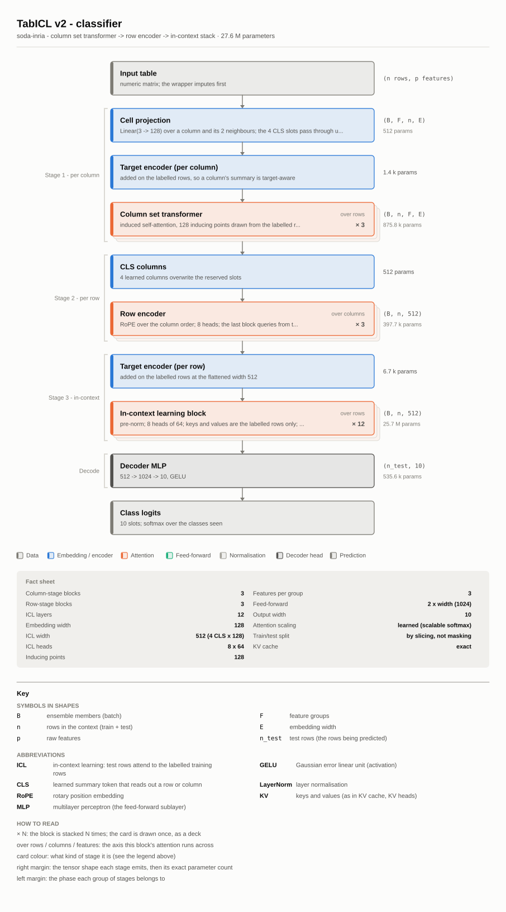{fig-alt="Stacked block
diagram of the TabICL v2 classifier"}

### TabFM

TabFM alternates: summarise the columns, mix the row, summarise the
columns *again*, mix the row again, then learn in context. Running each
stage twice is what separates it from TabICL's single pass, and the
second row stage is the one that collapses a table of any width to a
fixed 2048 numbers. It is by far the largest model here at 1.64 B
parameters — an ICL width of 2048 and a 4× SwiGLU feed-forward across
24 blocks accounts for nearly all of it.

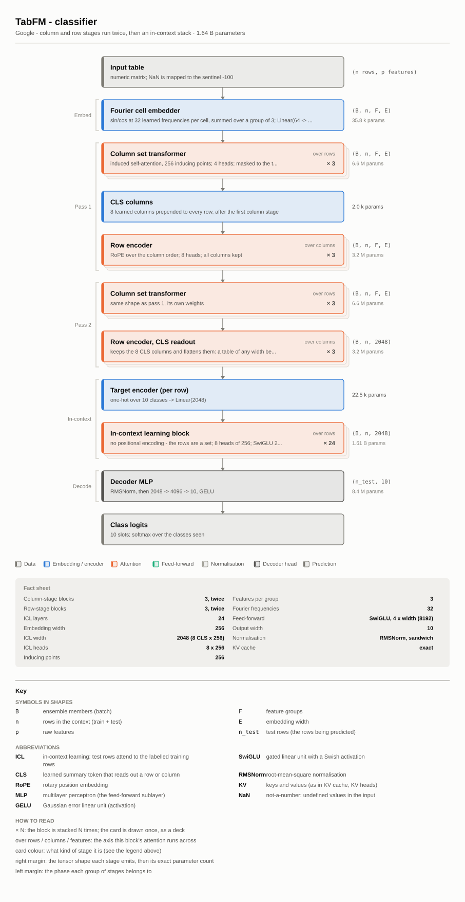{fig-alt="Stacked block diagram of
the TabFM classifier"}

### Mitra

The flattest of the eight. No column stage, no row stage, no in-context
stage — one stack of twelve identical layers, each attending across
rows and then across features, with an MLP after each. The target is
feature column 1, and the input transform is a fixed quantile-rank
mapping with no weights at all, which is why the first block on the
diagram reports no parameter count.

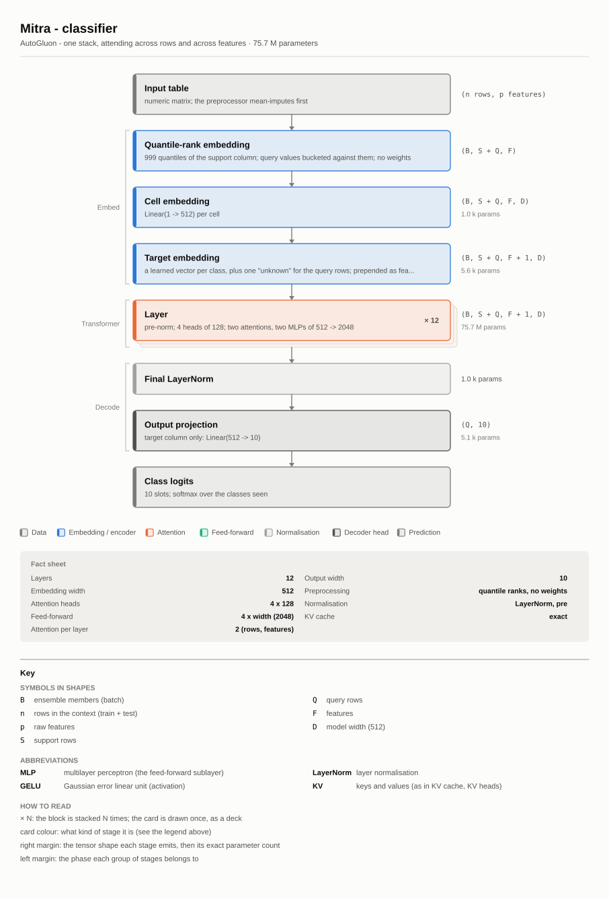{fig-alt="Stacked block diagram of
the Mitra classifier"}

### Kumo Tabular

NVIDIA's single-table in-context model, in three sizes of one
architecture. The same three stages as TabICL, with the details moved:
every cell is its own token (no grouping of features), embedded with its
two neighbours in a wrapping window and with context-mean imputation
plus a learned projection of what was missing, so the network sees
missingness rather than a filled-in value. Four readout tokens join each
row, and the column and row blocks alternate rather than running once
each — a column block summarises a column's context rows through
inducing points, a row block mixes the row's tokens with RoPE and a
gated, length-aware query scale.

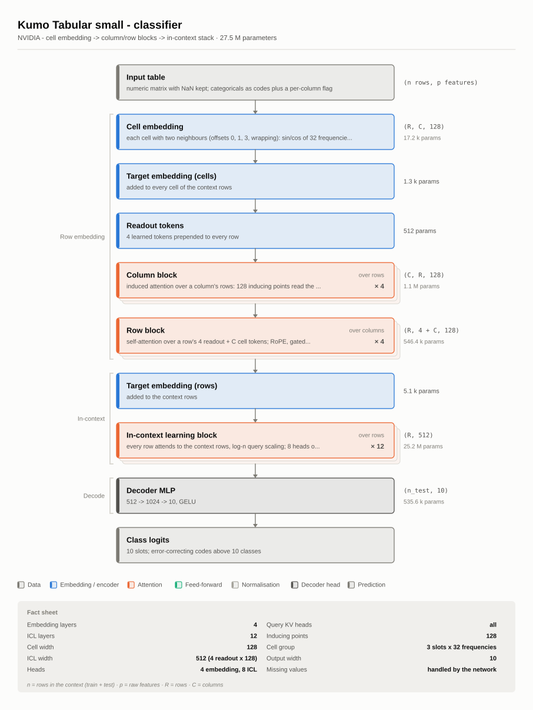{fig-alt="Stacked block
diagram of the Kumo Tabular small classifier"}

Medium widens the cells to 256 and doubles the depth of the in-context
stack, which then needs two things small does not: a projection from
the 1024 readout numbers down to the in-context width of 512, and
grouped-query attention, in which the test rows read the context through
only two of the eight key/value heads. Large drops the projection again
(1024 wide throughout) and keeps the grouping.

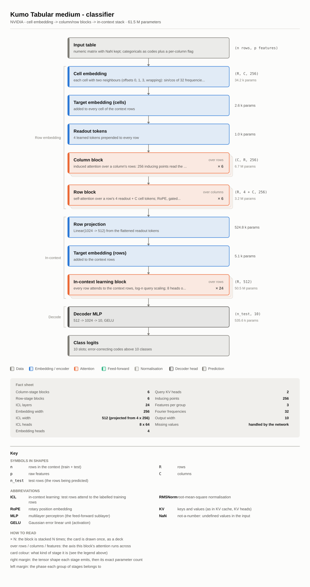{fig-alt="Stacked
block diagram of the Kumo Tabular medium classifier"}


## Opening a block up

`detail = "full"` expands each repeated stack into its sublayers, in the
order they run. This is where the axis tags earn their keep: TabPFN v3's
column stage attends over rows, its aggregator over columns, and its ICL
stack over rows again, all visible at once.

```{r}
#| eval: false
plot_architecture(clf, "tabpfn3-full.svg", detail = "full")
```

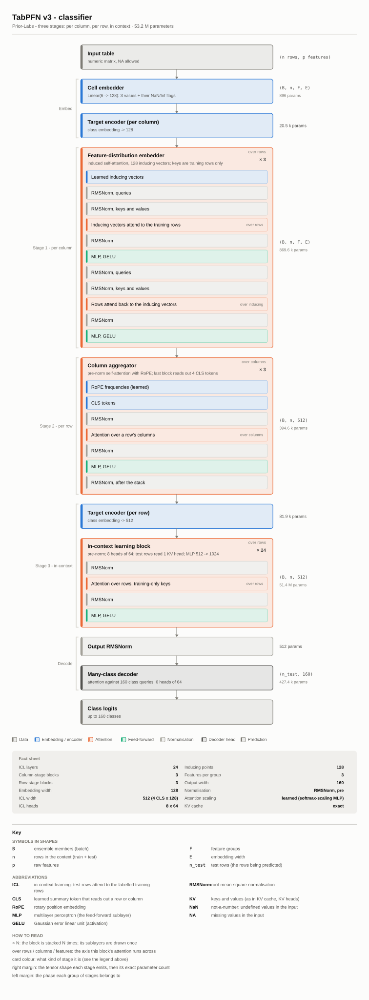{fig-alt="TabPFN
v3 with each repeated block expanded into its sublayers"}

## TabPFN v3.5

The same three stages as v3, with two visible changes. The cell embedder
is no longer a linear: a learned Fourier bank reads each value, and a
second projection reads its **in-context ECDF rank** -- where that cell
sits in its own column's distribution over the training rows -- so a
column's scale is accounted for before stage 1 begins. And the decoder
carries *both* heads, because one checkpoint serves both tasks; the
diagram draws the one the task selects and names the other as carried
but not run.

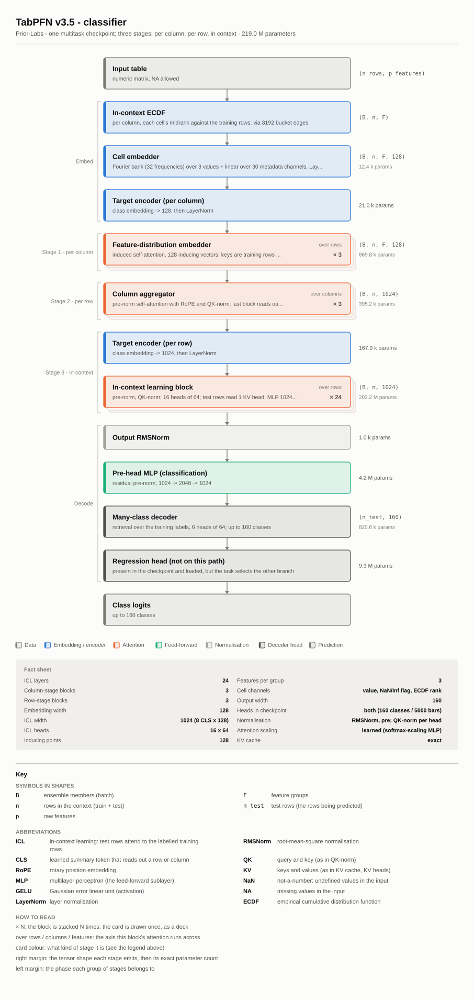{fig-alt="Stacked block
diagram of the TabPFN v3.5 classifier, from the in-context ECDF and
Fourier cell embedder through the per-column distribution embedder, the
column aggregator and the in-context stack to the many-class decoder."}

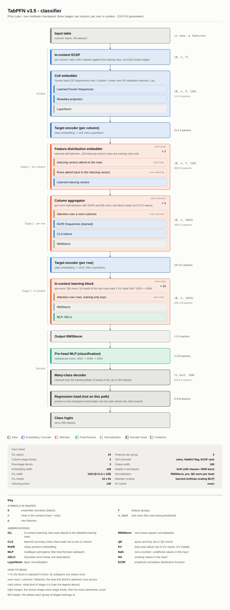{fig-alt="The
same diagram with every sublayer of each repeated block drawn out."}

## Themes

Both themes are stepped for their own surface rather than one being an
inversion of the other.

```{r}
#| eval: false
plot_architecture(clf, "tabicl-dark.svg", theme = "dark")
```

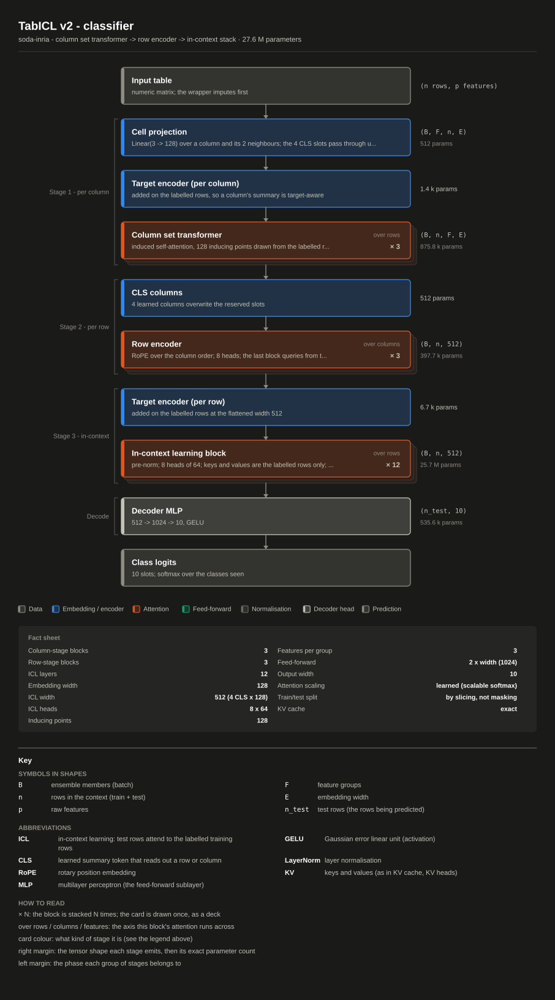{fig-alt="The TabICL
diagram on a dark surface"}

In the cards style, colour carries three identities — embedding,
attention, feed-forward — and everything else is neutral. That is a deliberate ceiling: with a
diagram whose blocks are read against each other rather than in
sequence, only three hues from the reference categorical palette clear
the colour-vision-deficiency separation floors. Every block is also
labelled in words and listed in the legend, so nothing is carried by
colour alone.

## Five ways to draw the same model

Every figure above is in the default style, `"cards"`. The same
description can be drawn four other ways, each answering a different
question. Pick one with `style`, or set
`options(tabfound.arch_style = )` once for a session.

```{r}
#| eval: false
icl <- tabular_classifier("tabicl-v2-classifier")
plot_architecture(icl, "tabicl-tufte.svg", style = "tufte")
plot_architecture(icl, "tabicl-glyphs.svg", style = "glyphs")
plot_architecture(icl, "tabicl-icicle.svg", style = "icicle")
plot_architecture(icl, "tabicl-schematic.svg", style = "schematic")
```

Every style ends in the same kind of key: each symbol in its shapes,
each abbreviation in its text and each piece of notation it uses is
defined on the figure itself.

### Tufte: how big each stage is

The stages become rows of a table, and each stage's parameter count is
a dot on a log scale that runs from 100 to 1 B in *every* diagram — so
two models' dots can be compared by eye across figures. It follows
Tufte's rules for statistical graphics: as little ink as the reading
needs, labels set beside what they name rather than in a legend, an axis
that runs only from the smallest dot to the largest. Position on a
common scale is also what Cleveland and McGill found people read most
accurately. Phases are coloured in stage order with viridis.

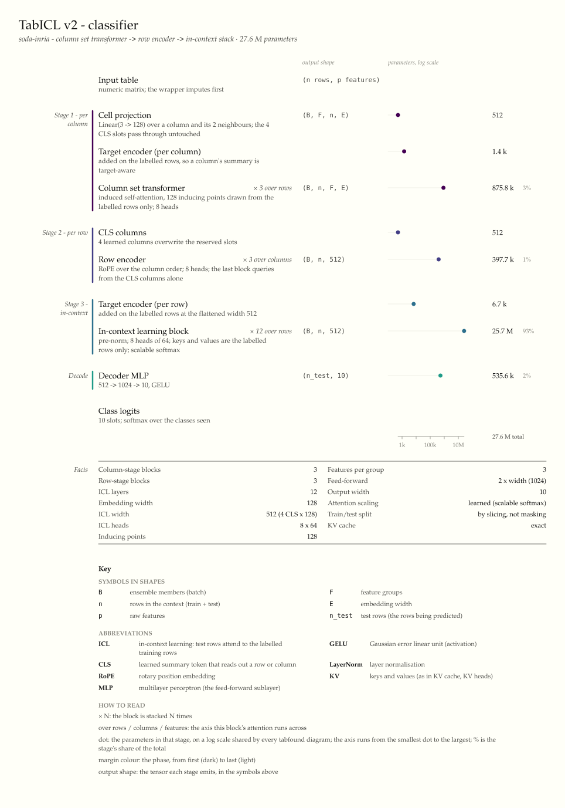{fig-alt="TabICL
v2 drawn as a table of stages with a dot per stage on a shared log
parameter scale; the in-context stack's dot sits furthest right at 25.7
million parameters, 93% of the total."}

### Glyphs: what each stage does to the table

Each stage is drawn as a small table, training rows above and test rows
below, with the part its attention runs over picked out: a column for
attention across rows, a row for attention across columns or features,
dots for inducing points. After TabICL's row encoder merges each row's
columns into one vector, the glyphs become a single wide column — the
moment the model stops seeing individual features.

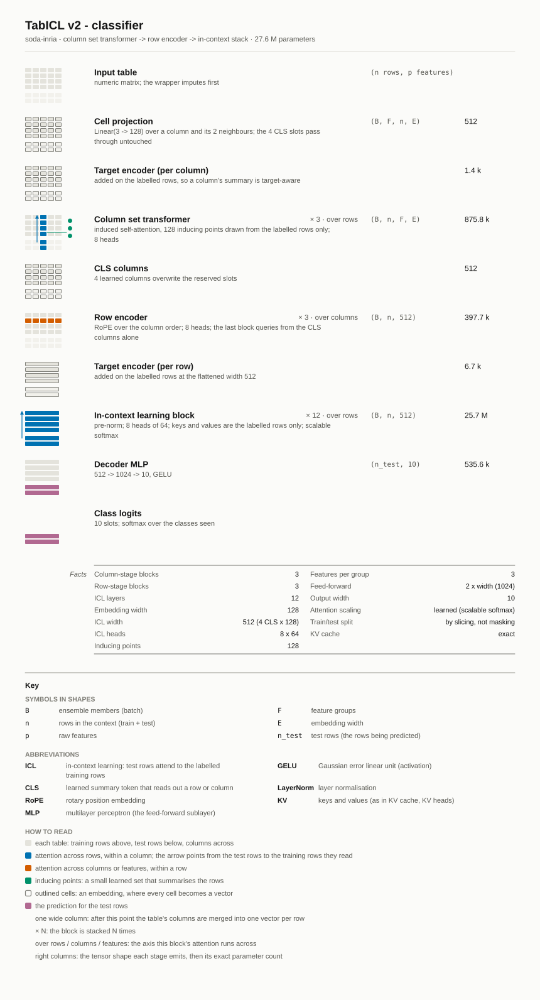{fig-alt="TabICL
v2 drawn as a column of small table glyphs, one per stage, highlighting
a column for attention across rows, a row for attention across columns,
and becoming a single wide column after the row encoder."}

### Icicle: where the parameters are

Three bands on one linear scale: the phases, the stages within them,
and each stage's sublayers summed over all of its stacked blocks. A
stage's width *is* its share of the model, so TabICL's in-context stack
fills nearly the whole page while its column and row stages are slivers.
Blocks too narrow to name are listed underneath with their counts. The
layout is Kruskal and Landwehr's icicle plot, turned on its side.

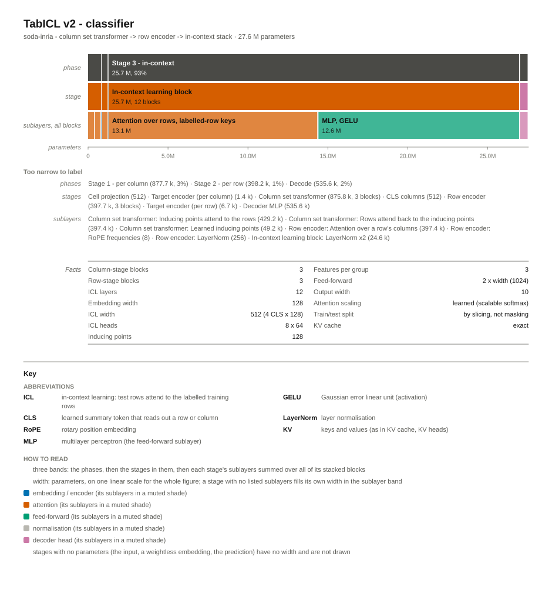{fig-alt="TabICL
v2 drawn as three horizontal bands of phases, stages and sublayers,
widths proportional to parameters; the in-context stack takes 93% of the
width, split between attention and the MLP."}

### Schematic: how a block runs

The convention of the papers -- the original Transformer figure, and
Sebastian Raschka's
[LLM architecture gallery](https://sebastianraschka.com/llm-architecture-gallery/)
-- applied to tabular models. The data flows upwards. Every repeated
block is opened into its steps in the order they run, inside a container
marked with how many times it is stacked, and each residual connection
is a line up the right-hand side that rejoins the flow at a circled
plus. Attention steps are dark, with a line saying which rows supply
their keys and how they differ from plain attention; what feeds a step
without being one -- a RoPE table, inducing points, QK-norm -- comes in
from the left; facts point at the part they describe. With
`detail = "full"`, a dotted box shows what each feed-forward computes
inside.

Everything on it is checked against the network: a test traces each
model's forward pass and requires the steps to be listed in the order
they run, each block's residual connections are pinned to its forward
code, and each feed-forward's widths must account for its parameters.

```{r}
#| eval: false
plot_architecture(icl, "tabicl-schematic-full.svg", style = "schematic",
                  detail = "full")
```

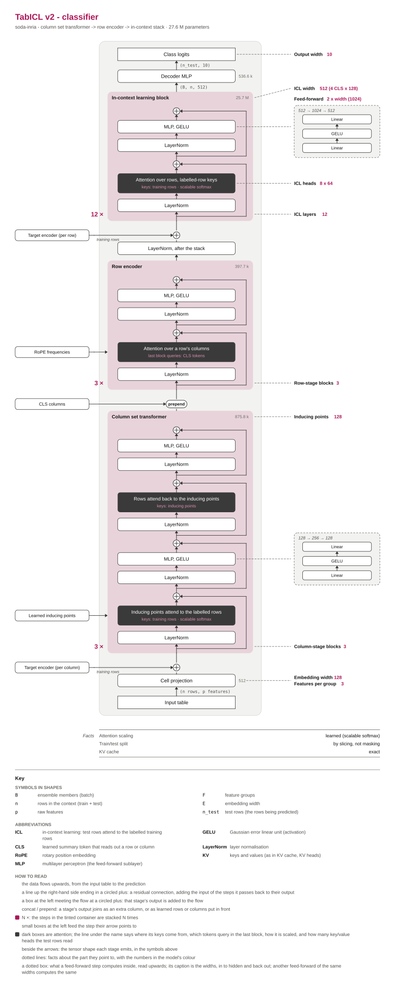{fig-alt="TabICL
v2 drawn bottom to top: the input table, cell projection and column
stage with its two induced-attention halves, CLS columns, the row
encoder, the in-context stack stacked 12 times with pre-norm residual
connections, and the decoder; dotted boxes beside the feed-forward steps
show Linear, GELU and Linear with their widths."}

The three below each show something the others do not. TabPFN v2.5
normalises *after* each residual add, so its norms sit above the
circled plus rather than inside the connection; its item attention
gives the test rows a single key/value head.

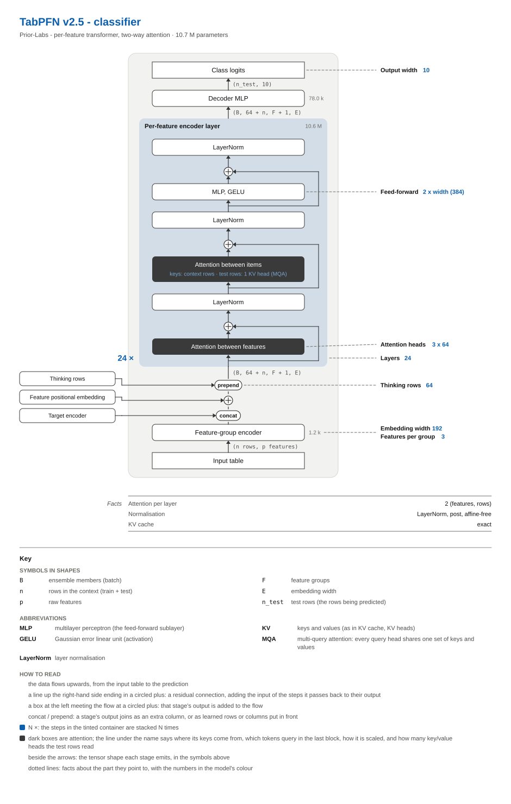{fig-alt="TabPFN
v2.5 drawn bottom to top: the target, positional embedding and thinking
rows joining the flow from the left, then 24 layers of attention between
features, attention between items and an MLP, each followed by a
LayerNorm placed after its residual add."}

Mitra's single stack attends twice per layer, across rows and then
across features, each with its own MLP -- four residual connections in
one block.

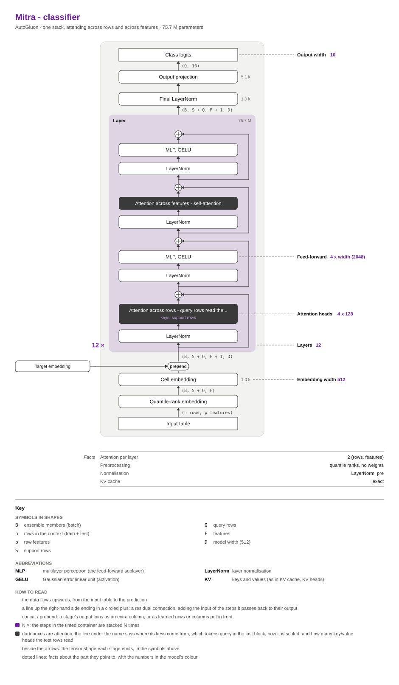{fig-alt="Mitra drawn
bottom to top: a weightless quantile-rank embedding, a cell embedding,
the target embedding prepended as a column, then 12 layers of attention
across rows, MLP, attention across features and MLP, each pre-norm with
its own residual connection."}

Kumo Tabular's column and row blocks take turns, one of each per layer,
so they share one container.

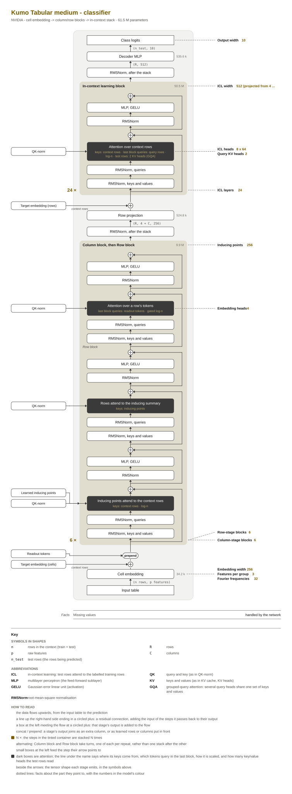{fig-alt="Kumo
Tabular medium drawn bottom to top: the cell embedding, target embedding
and readout tokens, then one container repeated six times holding an
induced-attention column block followed by a row block, then the row
projection and the in-context stack."}

### Your own colours

Every style takes a `background` and a `highlight`, so a diagram can sit
on a slide template or match a house style. The background carries the
style's greys, rules and panels with it -- each kept as far from it as
it was from the theme's own background, so the diagram reads the same --
and a dark background switches to the dark theme. The highlight
replaces what the style picks out: the schematic's accent, tufte's phase
colours, the attention colour in cards and icicle, row attention in
glyphs. Wherever it is drawn as text, or must stand out from a fill, it
is darkened or lightened just as far as it needs to be to stay readable.

```{r}
#| eval: false
plot_architecture(icl, "tabicl-brand.svg", style = "schematic",
                  background = "#0b1f3a", highlight = "#f2a900")
# plot_architecture_diff() takes the same two arguments; its highlight
# is model A, and model B moves to whichever colour stays apart from it.
```

## Comparing two models

`plot_architecture_diff()` sets two models side by side, stage against
stage. Stages are paired by their kind and the axis their attention
runs over, in order, not by name — so the pairing is structural: TabPFN
v3's many-class decoder pairs with TabICL's decoder MLP because both are
decoders. The chip between each pair says whether they match, how their
stack depths differ, or that a stage has no counterpart. Facts are
paired by name; the backends share one vocabulary of fact names so that
"ICL layers" in one model lines up with "ICL layers" in the other.

```{r}
#| eval: false
pfn <- tabular_classifier("tabpfn-v3-classifier")
plot_architecture_diff(icl, pfn, "diff-tabicl-tabpfn3.svg")
```

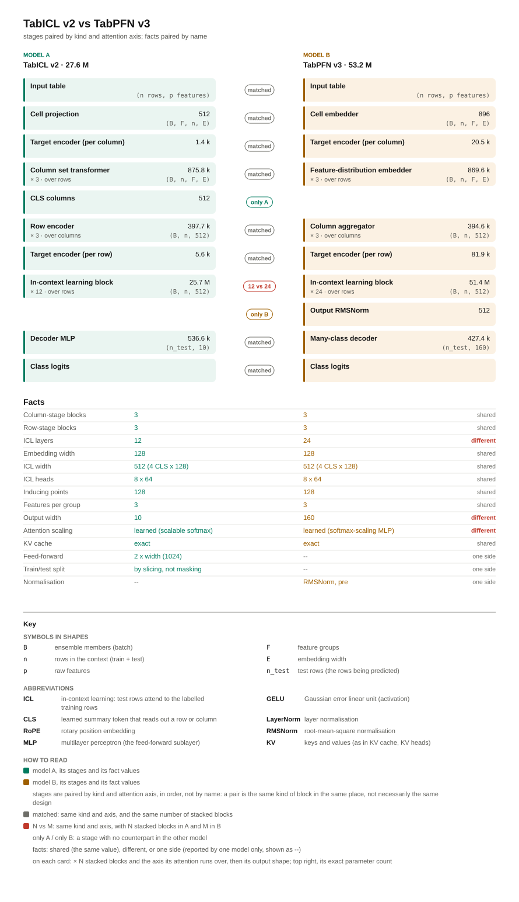{fig-alt="TabICL
v2 and TabPFN v3 side by side: most stages match; TabICL's CLS columns
and TabPFN v3's output RMSNorm have no counterpart, and the in-context
stacks differ in depth, 12 blocks against 24."}

## The description behind the picture

The figure is one rendering of a structured object, and the object is
useful on its own:

```{r}
#| eval: false
arch <- tabfound_architecture(clf)
arch                                  # the same information as text
as.data.frame(arch)                   # one row per stage
as.data.frame(arch, detail = "full")  # sublayers too
```

For the v3 classifier above, dropping the `parent`, `detail`, `shape`,
`collapses` and `interleave` columns to fit the page:

```
#>    stage                         label      kind    axis repeats   params
#>    input                   Input table     input    <NA>       1       NA
#>  x_embed                 Cell embedder     embed    <NA>       1      896
#>    col_y   Target encoder (per column)     embed    <NA>       1    20480
#>     dist Feature-distribution embedder attention    rows       3   869616
#>      agg             Column aggregator attention columns       3   394632
#>    icl_y      Target encoder (per row)     embed    <NA>       1    81920
#>      icl     In-context learning block attention    rows      24 51357696
#>    onorm                Output RMSNorm      norm    <NA>       1      512
#>      dec            Many-class decoder    decode    <NA>       1   427392
#>   output                  Class logits    output    <NA>       1       NA
```

Each stage declares which parameter-name prefixes it owns, which is how
the counts are exact and how the descriptions are kept honest: the
package's tests assert, for every backend, that each parameter in the
network is claimed by exactly one stage. A backend that grows a
submodule fails that test until its description grows one too — so a
diagram cannot quietly drift from the model it claims to describe.

## Adding a backend

A backend supplies its stage list through the registry, so a new model
becomes drawable with the same one call that registers it:

```{r}
#| eval: false
register_backend(
  name     = "mymodel",
  build    = mymodel_build,
  describe = mymodel_describe,   # (config, task) -> list(title, facts, stages)
  ...
)
```

`describe` returns a title, a subtitle, a named `facts` vector and a
list of `arch_stage()`s. Everything else — layout, the three formats,
both themes, the parameter accounting — is shared.

### Where things live

```
R/core-*.R            device, artifact resolution, download + convert, state-dict loader, registry
R/core-memory.R       memory preflight: availability probe, peak estimator, the fit/predict guard
R/api.R               tabular_classifier() / tabular_regressor() + S3 methods
R/nn-*.R              shared layers: attention variants, norms, RoPE, blocks, MLPs
R/prep-transforms.R   TabPFN's own column transforms (squashing, quantile, SVD, fingerprint)
R/prep-sklearn.R      the stock sklearn transformers the other three wrappers chain
R/prep-ensemble.R     the ensemble generators + Mitra's preprocessor
R/py-random.R         CPython's random.Random, which decides every ensemble member
R/dist-*.R            output heads (TabPFN's bar distribution, TabICL's quantile distribution)
R/mi*.R               multiple imputation + the mice / Amelia bridges
R/syn*.R              sequential synthesis + the synthpop bridges
R/backend-*-layers.R  family-specific blocks where conventions diverge
R/backend-*.R         one model family each (`backend-tabpfn3.R` is TabPFN v3)
inst/memory/          peak-memory calibration harness, measurements + fitted coefficients
inst/parity/          the parity harness
inst/python/          one-time checkpoint conversion
```

Adding a backend means one `register_backend()` call plus its layers —
no changes to the core. See `?register_backend`.
